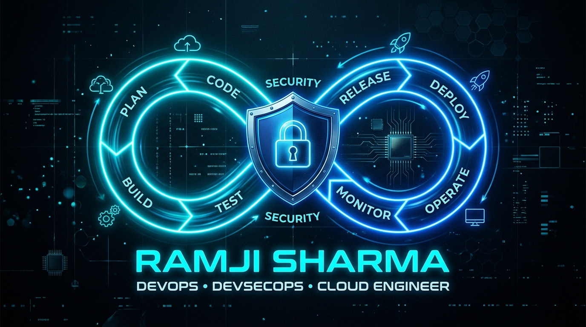

  <!-- HERO BANNER (DEVOPS INFINITY LOOP LOGO) -->
  

    

  <h1>Hi, I'm Ramji Sharma 👋</h1>
  <h3>⚡ Senior Cloud, DevSecOps &amp; GenAI Consultant</h3>

  

    <!-- Quick Contact Badges -->
    
    
    
    
    
    
  

  <!-- DYNAMIC TYPING SVG -->
  

---

## 🚀 About Me

I'm a **DevOps and Cloud Specialist** with **5+ years of dedicated experience (11+ years total in IT)** designing, securing, and automating cloud infrastructure on **Microsoft Azure & AWS**. I specialize in **Infrastructure as Code (Terraform)**, secure **CI/CD automation (Azure DevOps, GitHub Actions)**, and embedding security across the SDLC — turning manual, error-prone deployments into repeatable, auditable, self-service pipelines.

- 🔭 **Currently working as:** DevOps Engineer for **HDFC Bank** client in Mumbai — *Onsite*
- 🛡️ **Focused on:** Shift-left security, policy-as-code, and GitOps-driven delivery
- ☁️ **Cloud Depth:** Deep hands-on experience across Dev / QA / Production Azure & AWS environments
- 🌱 **Currently exploring:** GenAI-assisted DevOps workflows, **Model Context Protocol (MCP)**, **RAG**, and Autonomous Platform Engineering
- 💬 **Ask me about:** Terraform, Azure DevOps, Kubernetes (AKS/EKS), CI/CD security, and FinOps
- 📫 **Reach me at:** [ramjish0586@gmail.com](mailto:ramjish0586@gmail.com) | [+91-7021381066](tel:+917021381066)

---

## 🏆 Key Enterprise Highlights (BFSI & High Availability)

- 🏦 **Tier-1 BFSI Operations:** Architected & maintained mission-critical CI/CD pipelines & landing zones for **HDFC Bank** and **IDFC First Bank** maintaining **99.9% production SLA**.
- ⚙️ **Terraform Automation:** Engineered reusable parent/child Terraform modules reducing deployment cycles by **65%** and manual effort by **40%**.
- 🔒 **Zero-Trust & Shift-Left:** Eliminated long-lived service principal secrets using **OIDC Workload Identity Federation**; integrated automated security gates (**tfsec, TFLint, TruffleHog, Trivy, SonarQube**).
- 📜 **Verified Credentials:** 
  - Microsoft Certified: **Azure Administrator Associate** (ID: `1702FA6DE9297169`)
  - AWS Certified: **Solutions Architect – Associate** (ID: `W9T0MMELQF411D3W`)
  - Red Hat Certified: **System Administrator (RHCSA)**

---

## 🛠️ Tech Stack

### ☁️ Cloud Platforms

  
  
  

### 🏗️ Infrastructure as Code

  
  
  
  
  

### 🐳 Containers & Orchestration

  
  
  
  
  
  

### 🔁 CI/CD & GitOps

  
  
  
  
  

### 🔐 DevSecOps & Security

  
  
  
  
  
  
  
  
  

### 📊 Monitoring, Cost & Observability

  
  
  
  
  
  

### 🤖 GenAI & Autonomous DevOps

  
  
  
  

### 💻 Scripting & Version Control

  
  
  
  
  
  

### 🖥️ Operating Systems

  
  
  

---

## 📊 Live GitHub Engineering Metrics

  <table border="0">
    <tr>
      <td width="50%" align="center">
        
      </td>
      <td width="50%" align="center">
        
      </td>
    </tr>
    <tr>
      <td colspan="2" align="center">
        
      </td>
    </tr>
  </table>

---

## 🤝 Let's Connect!

I'm always open to discussing **Cloud Architecture, DevSecOps transformations, GenAI platform tooling, or enterprise consulting**:

  
  &nbsp;
  
  &nbsp;
  
  &nbsp;
  

    
  📍 Based in <strong>Mumbai, India</strong> • Open to Senior / Lead DevSecOps &amp; Cloud Platform Engagements

